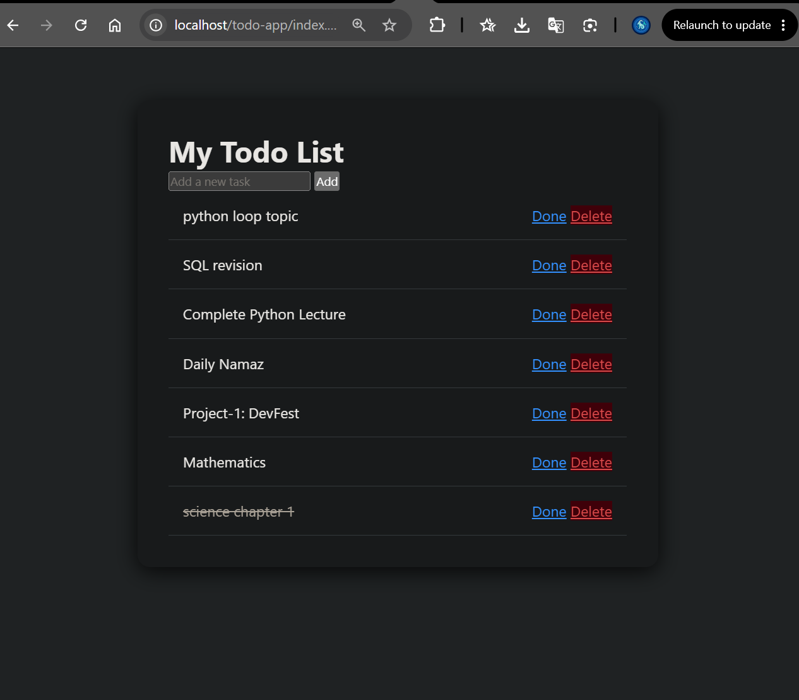
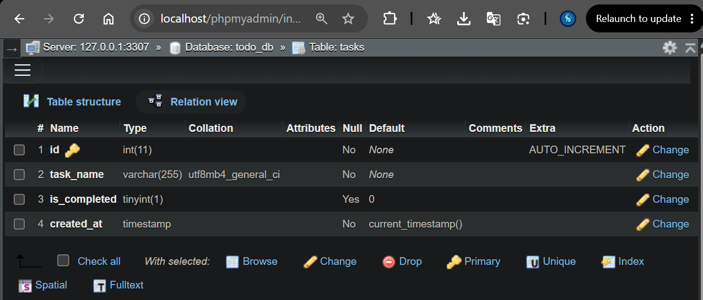
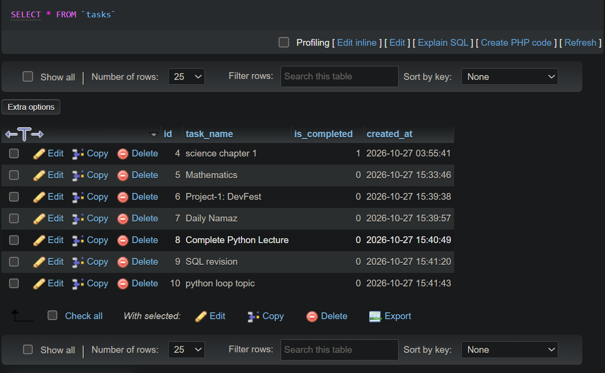

# PHP Todo List Application

A simple and interactive Todo List web application built using PHP, MySQL, HTML, CSS, and JavaScript.

This project demonstrates the fundamentals of server-side web development, database operations, CRUD functionality, and frontend interaction.

##  Application Preview



##  Features

- **Add Tasks:** Create new tasks and store them in the database.
- **View Tasks:** Display saved tasks dynamically from MySQL.
- **Complete Tasks:** Mark tasks as completed.
- **Toggle Task Status:** Switch a task between completed and incomplete, if supported by the current implementation.
- **Delete Tasks:** Remove tasks from the database.
- **Delete Confirmation:** Display a confirmation dialog before deleting a task.
- **Input Validation:** Prevent empty task submissions.
- **Persistent Storage:** Keep tasks stored in the database.
- **Dark UI:** A dark-themed interface styled with CSS.
- **Dynamic Rendering:** Use PHP to display database records.

##  Technologies Used

| Technology | Purpose |
|---|---|
| PHP | Server-side logic and database operations |
| MySQL | Store and manage tasks |
| HTML5 | Structure the application interface |
| CSS3 | Style the application |
| JavaScript | Input validation and delete confirmation |
| Git | Version control |
| GitHub | Remote repository hosting |
| XAMPP | Local development environment |

## Project Structure

```text
todo-app/
├── config.php
├── index.php
├── add_task.php
├── complete_task.php
├── delete_task.php
├── style.css
├── script.js
├── README.md
└── screenshots/
    ├── todo-app.png
    ├── database-structure.png
    └── database-records.png
```

##  Database Overview

The application uses a MySQL database to store tasks.

The `tasks` table contains fields used for identifying tasks, storing task names, and tracking completion status.

### Database Structure



### Stored Task Records



##  Installation and Setup

Follow these steps to run the project locally.

### 1. Install XAMPP

Install XAMPP with Apache, PHP, and MySQL or MariaDB support.

### 2. Clone the Repository

Open your terminal and run:

```bash
git clone https://github.com/Ahmad-Khuraim/php-todo-app.git
```

### 3. Move the Project

Place the project folder inside the XAMPP `htdocs` directory.

Example:

```text
C:\xampp\htdocs\todo-app
```

### 4. Start XAMPP Services

Open the XAMPP Control Panel and start:

- Apache
- MySQL

### 5. Create the Database

Open phpMyAdmin:

```text
http://localhost/phpmyadmin/
```

Create the database and `tasks` table required by the application.

**Important:** Configure the database name, table structure, and connection credentials to match your actual project configuration. The exact SQL schema and database name should be documented after verifying `config.php` and the existing database.

### 6. Configure the Database Connection

Open `config.php` and configure the database connection settings.

Use your local MySQL credentials and the correct database name.

Do not upload real passwords or other sensitive credentials to GitHub.

### 7. Run the Application

Open your browser and visit:

```text
http://localhost/todo-app/index.php
```

You should now be able to use the Todo List application.

##  How It Works

1. The user opens the main page.
2. PHP retrieves saved tasks from MySQL.
3. The user submits a new task through the form.
4. `add_task.php` validates the request and inserts the task into the database.
5. `complete_task.php` updates the selected task's completion status.
6. `delete_task.php` removes the selected task after confirmation.
7. The browser returns to the main page to display the updated task list.

##  Security Considerations

- Use prepared statements for database queries.
- Validate user input on the server.
- Escape task text before rendering it in HTML.
- Avoid exposing database passwords and private credentials.
- Use appropriate access controls before deploying the application publicly.

##  Learning Outcomes

Through this project, I practised:

- PHP fundamentals and form handling.
- Connecting PHP with MySQL.
- Performing database CRUD operations.
- Using prepared statements.
- Rendering dynamic content with PHP.
- Styling a web application with CSS.
- Adding frontend validation and confirmation dialogs with JavaScript.
- Managing project changes with Git and GitHub.

##  Future Improvements

- Add user registration and login.
- Add task editing functionality.
- Add task categories and priorities.
- Add due dates and reminders.
- Improve mobile responsiveness.
- Add filtering for completed and pending tasks.
- Deploy the application to a public hosting platform.

##  Author

**Ahmad Khuraim**

GitHub: [Ahmad-Khuraim](https://github.com/Ahmad-Khuraim)

Repository: [PHP Todo App](https://github.com/Ahmad-Khuraim/php-todo-app)

---

If you find this project useful, consider giving the repository a ⭐ on GitHub 😊.